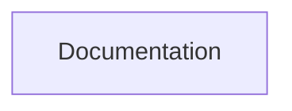

## Stack
Not a code project yet. Repo root contains only `README.md` and `.gitignore` — no manifest (no package.json), no source files, no entry points exist on disk. README describes it as a planned Node.js learning repository (CommonJS, core modules) but the referenced content (`Test 1 (Global Object Module)`) is not present in the tree.

## Directory map
| path | what lives there |
|---|---|
| `/` | `README.md`, `.gitignore` — only files in the repo |

## Diagram

## Component index
- [[Documentation]] — the only component; see note below.

## Entry points
- Dev: none present. TODO: verify — README references `Test 1 (Global Object Module)/*.js` but no such folder exists in the repo tree.
- Prod: none present.

## Conventions
- None observed — no source files exist to derive conventions from.

## Where things go
- To add the first topic folder described in the README (`Test 1 (Global Object Module)`), create it at repo root and add `.js` files per README's "How to Use" section.
- To add a manifest, create `package.json` at repo root (none exists currently).
- To document new topics, add rows to the "Contents" table in `README.md`.
