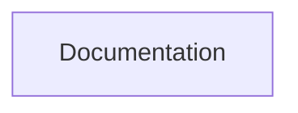

# Node.js - Learning Repository

A learning repository for Node.js covering server-side JavaScript fundamentals, the global object, module system, and core Node.js concepts.

## Architecture / How it Works




---

## Contents

| Folder | Description | Key Concepts |
|--------|-------------|--------------|
| `Test 1 (Global Object Module)` | Introduction to Node.js global objects and the module system | Global object, `__dirname`, `__filename`, `require`, `module.exports`, built-in modules |

---

## Prerequisites

- **Node.js** (v16 or higher) and **npm** installed
- Basic understanding of JavaScript (ES6+)
- A code editor such as VS Code
- Familiarity with the terminal/command line

---

## How to Use

1. Clone this repository:
   ```bash
   git clone <repository-url>
   cd Node.js
   ```

2. Navigate into a topic folder and run JavaScript files with Node:
   ```bash
   cd "Test 1 (Global Object Module )"
   node <filename>.js
   ```

3. Experiment by modifying the files and observing output in the terminal.

---

## Topics Covered

- **Global Object** -- Understanding `global`, `process`, `console`, `setTimeout`, `setInterval`
- **Module System** -- CommonJS modules, `require()`, `module.exports`, creating custom modules
- **Built-in Modules** -- `fs`, `path`, `os`, `http`, and other core modules

---

## Resources

- [Node.js Official Documentation](https://nodejs.org/docs/)
- [Node.js Guides](https://nodejs.org/en/learn)
- [MDN - Server-side JavaScript](https://developer.mozilla.org/en-US/docs/Learn/Server-side/Node_server_without_framework)
